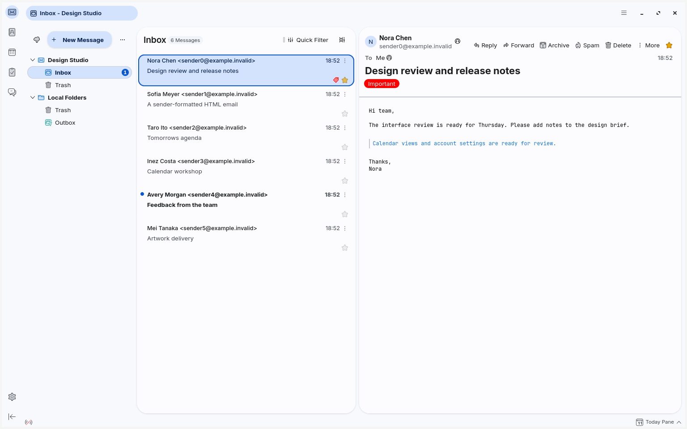
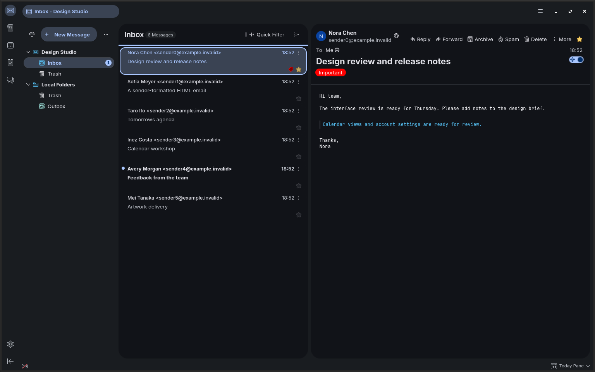
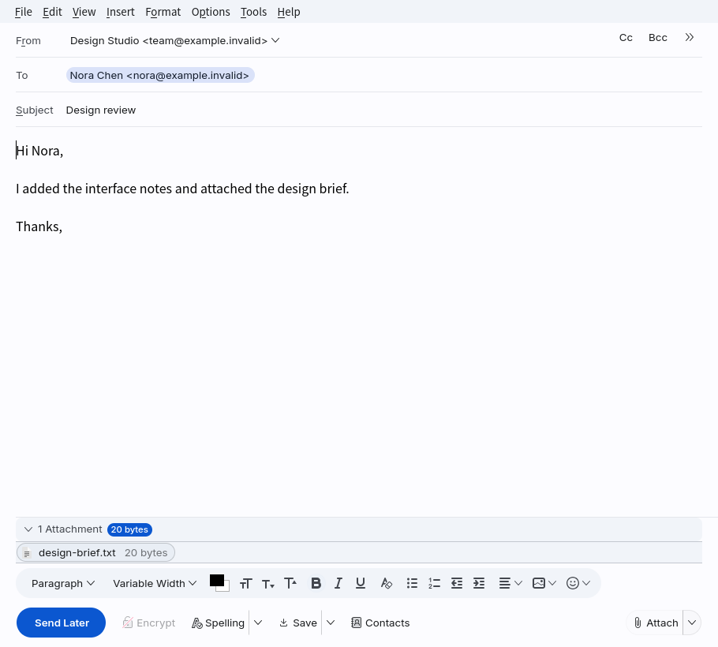

# MDBird

MDBird is a Material Design 3 Expressive theme for Thunderbird. Its default palette is inspired by Gmail.

In windows at least 900 CSS pixels wide, MDBird places the tabs in the top toolbar row to save vertical space. It replaces the toolbar search box with a button in the sidebar. Click the magnifying glass in the Spaces Toolbar on the left or press `Ctrl+K` (`⌘K` on macOS) to open the MDBird search box. Type a keyword and press Enter to see global search results in a new Thunderbird tab.







## Installation

The installer supports common profile locations on Linux and macOS. On Windows, follow the [manual installation steps](docs/installation.md#manual-installation).

Quit Thunderbird, then run the installer from the project directory.

```bash
./install.sh
```

The script locates the default profile. You can specify a profile path and use `--accent` to choose `blue`, `violet`, or `mint`.

```bash
./install.sh --profile ~/.thunderbird/xxxxxxxx.default-release --accent violet
```

After restarting Thunderbird, open the MDBird Search installation prompt from the application menu in the upper-right corner and select **Enable**. Light and dark colors follow the default, light, or dark theme selected in Thunderbird.

To uninstall MDBird, run `./install.sh --uninstall` and restart Thunderbird. See the [installation guide](docs/installation.md) for profile paths, updates, and troubleshooting.

## Customization

Edit `chrome/mdbird/theme/customization.css` in your profile to adjust fonts, corner radii, and panel spacing. Both stylesheet entry points use `theme/palette.css`, so changing the palette updates the main window and built-in content tabs. See the [customization guide](docs/customization.md) for details.

The main window loads its styles from `userChrome.css`. Settings and other built-in tabs use `userContent.css`, as do plain-text messages and the compose editor. HTML messages use the sender's formatting and Thunderbird's dark mode setting for reading messages. See the [design guide](docs/design.md) for the interface structure, selector scope, and platform controls.
