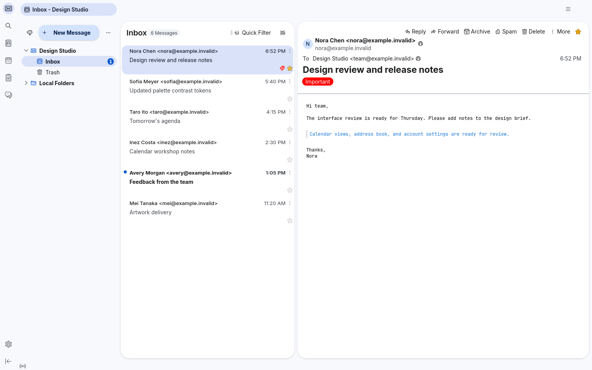
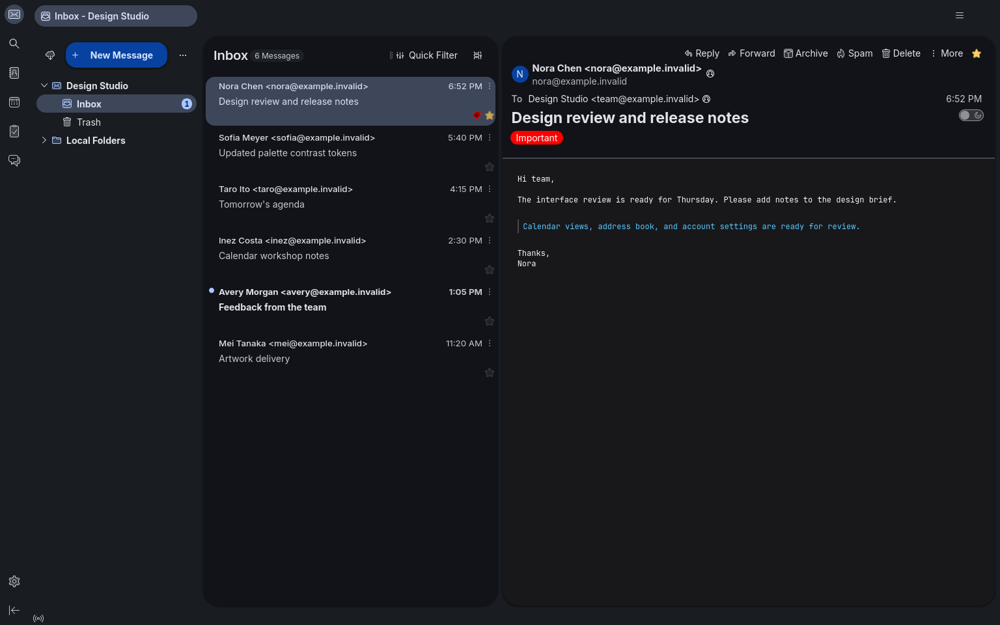
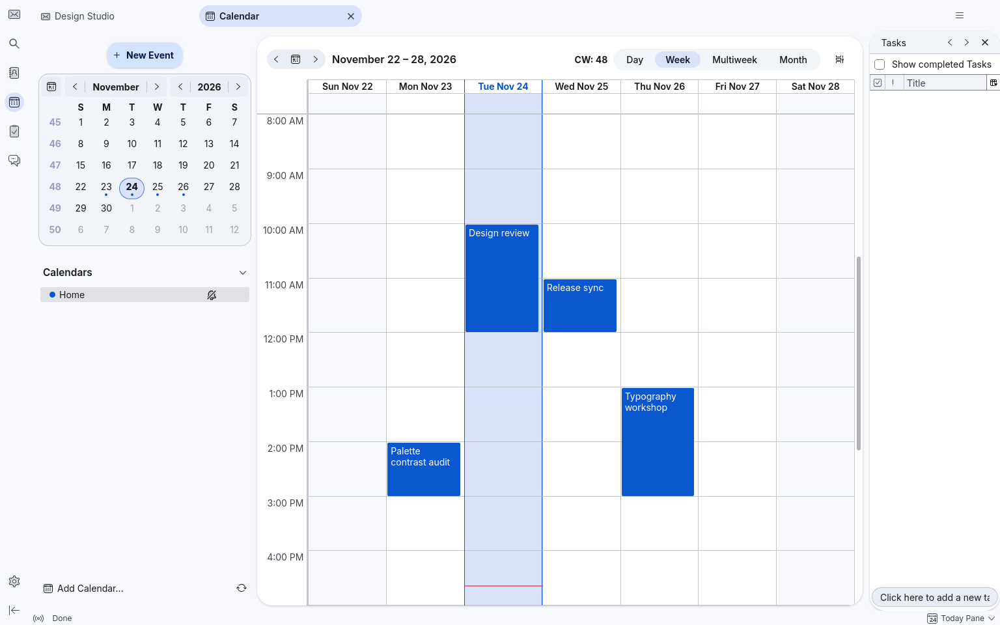
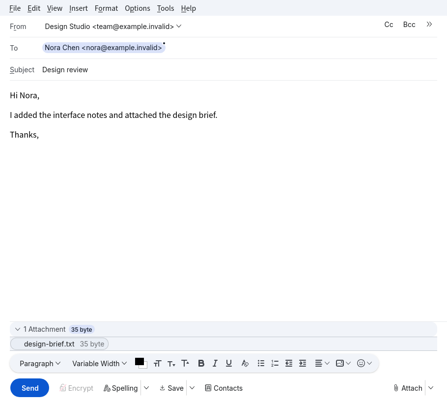

# MDBird

MDBird brings a Material Design 3 Expressive interface to Thunderbird, pairing a Gmail-inspired three-pane workspace with tonal surfaces, rounded content cards, spring-driven shape morphing, and full light and dark color schemes. The theme covers the main mail window, standalone message and compose windows, Calendar, Tasks, Address Book, Chat, menus, dialogs, and built-in settings and utility tabs.

On windows that are at least 900 CSS pixels wide, MDBird places the tab bar alongside the unified toolbar to reclaim vertical reading space and moves global mail search out of the top bar into the Spaces Toolbar on the left. Clicking the search icon in the sidebar or pressing `Ctrl+K` (`⌘K` on macOS) opens the MDBird Search popup, which forwards queries to Thunderbird's global index and displays results in a standard search tab.









## Installation

Quit Thunderbird completely before running the installer from the repository root on Linux or macOS. For Windows or step-by-step setup without the script, follow the [manual installation guide](docs/installation.md#manual-installation).

```bash
./install.sh
```

The installer detects the default profile from `profiles.ini`, copies the stylesheets into `<profile>/chrome/mdbird`, adds the managed `@import` blocks to `userChrome.css` and `userContent.css`, enables `toolkit.legacyUserProfileCustomizations.stylesheets` in `user.js`, packages the sidebar search add-on, and clears `startupCache` so Thunderbird reads the updated files on launch. Pass `--profile` to target a specific profile directory or `--accent` to select `blue` (default), `violet`, or `mint`:

```bash
./install.sh --profile ~/.thunderbird/xxxxxxxx.default-release --accent violet
```

After restarting Thunderbird, open the application menu in the upper-right corner and confirm **Enable** on the MDBird Search prompt so the sidebar search button and `Ctrl+K` shortcut activate. Light and dark surfaces follow the theme selected in Thunderbird's Add-ons and Themes manager. To remove MDBird cleanly, run `./install.sh --uninstall` and restart Thunderbird; see the [installation guide](docs/installation.md) for profile locations, update behavior, and troubleshooting.

## Customization

Edit `chrome/mdbird/theme/customization.css` inside your profile directory to override fonts, pane gaps, corner radii, or selection colors for chrome windows; the installer preserves this file across updates. Because both `userChrome.css` and `userContent.css` import the same active palette through `theme/palette.css`, switching accents or defining a custom palette keeps the main window, popups, dialogs, and built-in content tabs synchronized.

Plain-text email bodies and the compose editor inherit only canvas margins and quote styling through `userContent.css`, while HTML messages retain the sender's formatting and respect Thunderbird's built-in dark reading toggle. See the [customization guide](docs/customization.md) for variable references and palette authoring, and the [design guide](docs/design.md) for architecture, Material 3 Expressive token mapping, and scope boundaries.
